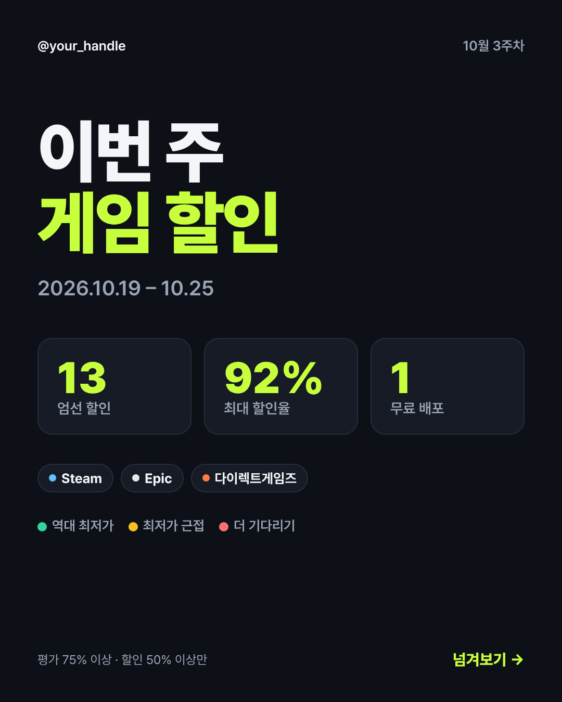
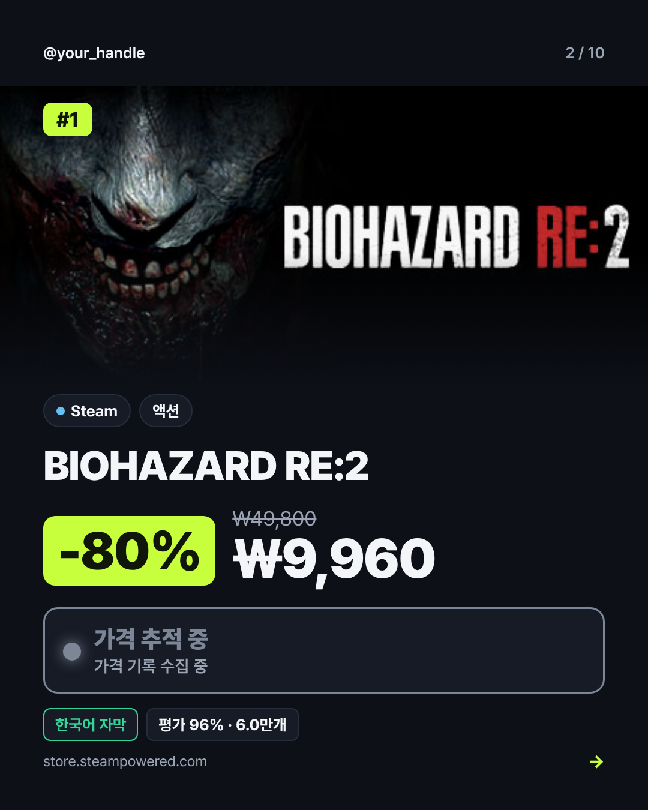
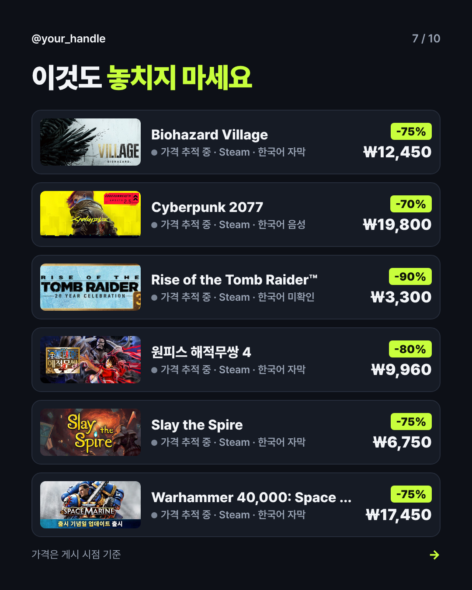
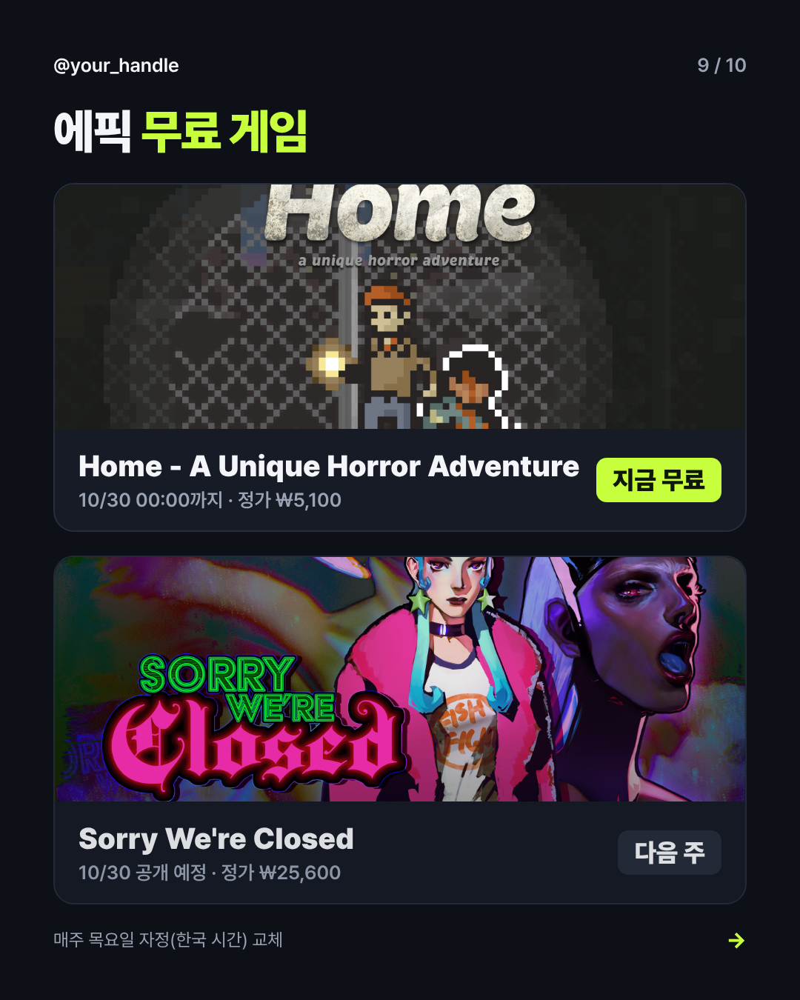
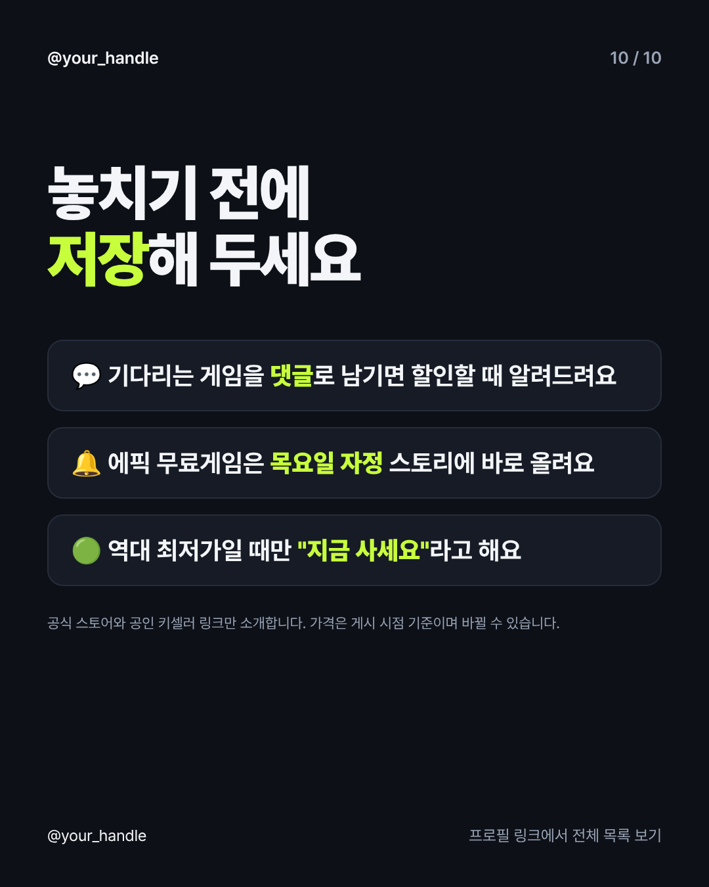

# 캐러셀 템플릿 디자인

템플릿 파일: `dealbot/templates/carousel.html.j2` (HTML/CSS → Playwright로 1080×1350 PNG 렌더링)
샘플: [`docs/samples/`](samples/)

| 표지 | 메인 카드 | 목록 | 에픽 무료 | 마지막 장 |
|---|---|---|---|---|
|  |  |  |  |  |

## 슬라이드 구성 (최대 20장)

1. **표지**: "이번 주 게임 할인", 주차와 기간, 엄선 개수 / 최대 할인율 / 무료 개수, 포함 스토어, 판정 범례
2. **메인 카드 ×5**: 순위, 스토어 칩, 장르, 할인율, 할인가와 정가, **판정 배지**, 한국어 지원, 평가
3. **목록**: 6개씩. 썸네일, 판정 점, 스토어, 한국어, 할인율, 가격
4. **에픽 무료**: 지금 무료와 다음 주 예정
5. **마지막 장**: 저장, 댓글 위시리스트, 정시 알림 안내, 신뢰 문구, (제휴 시) 광고 표기

## 디자인 원칙

- **4:5 세로(1080×1350)**: 피드에서 가장 큰 면적을 차지하는 비율
- **한 장에 메시지 하나**: 할인율(형광 블록)과 가격이 가장 크게, 판정은 신호등 색으로
- **브랜드 컬러 하나**: 다크 배경(#0d1017)과 형광 라임(#c8ff3c). 피드에서 한눈에 이 계정임을 알아보게
- **판정 색 고정**: 🟢 #34d399 역대 최저 / 🟡 #fbbf24 근접 / 🔴 #f87171 대기 / ⚪ 회색 추적 중
- **스토어별 점 색**: Steam 하늘, GOG 보라, Epic 흰색, 다이렉트게임즈 주황, STOVE 빨강
- 글꼴: Pretendard (OFL, CDN 로드)

## 커스터마이즈

- 핸들: `DEALBOT_HANDLE=@내핸들`
- 색상: 템플릿 상단 `:root` 변수만 바꾸면 전체에 반영
- 메인 카드 장수: `DEALBOT_HERO_SLIDES`
- 문구: 템플릿의 `cta` 블록, `render.py`의 `caption()`과 `VERDICT_LABELS`
